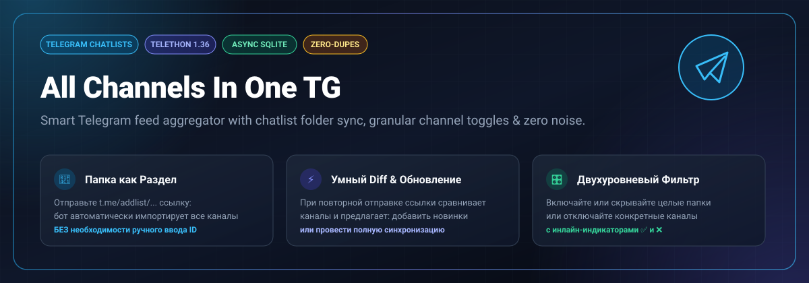
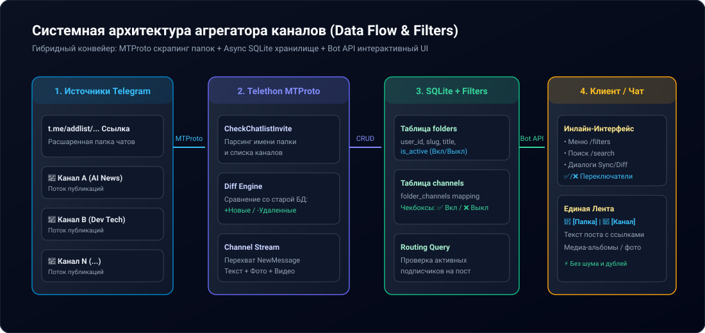

<div align="center">



# All Channels in One TG (Telegram Feed Aggregator)

**Умный агрегатор Telegram-каналов на основе расшаренных папок (`t.me/addlist/...`) с двухуровневыми фильтрами, поиском и синхронизацией новинок.**

[](https://www.python.org/)
[](https://github.com/LonamiWebs/Telethon)
[](https://www.sqlite.org/)
[](#тестирование)
[](#запуск-в-docker)
[](LICENSE)

[Обзор](#описание-и-проблема) • [Возможности](#ключевые-возможности) • [Архитектура](#архитектура) • [Быстрый старт](#быстрый-старт) • [Команды](#команды-бота) • [Docker](#запуск-в-docker) • [Roadmap](#roadmap)

</div>

---

## 📌 Описание и проблема

Подписки на десятки каналов превращают ленту Telegram в информационный шум:
* Посты теряются в архиве и закреплённых диалогах.
* Приходится вручную копировать ID каналов и настраивать сложных ботов-пересыльщиков.
* Нет возможности гибко отключить один назойливый канал из тематической подборки без отписки от всей папки.

**All Channels in One TG** решает это на уровне Telegram Chatlists:
Вы просто отправляете боту ссылку на расшаренную папку (`https://t.me/addlist/...`). Бот считывает её через MTProto, сохраняет как отдельный раздел и транслирует все посты в единый диалог с вами, позволяя гибко управлять видимостью как всей папки, так и каждого отдельного канала.

---

## ✨ Ключевые возможности

* 📁 **Папка как раздел за 1 клик:** Никаких ID чатов. Достаточно отправить ссылку `t.me/addlist/...`.
* 🎛️ **Двухуровневая фильтрация контента:**
  * **Уровень раздела:** Показывать или полностью скрыть целую папку (`🟢 Включить` / `🔴 Скрыть`).
  * **Уровень канала:** Внутри раздела можно выключать отдельные каналы чекбоксами `✅` и `❌`.
* ⚡ **Интеллектуальная синхронизация папок (Diff Engine):**
  * Если вы повторно отправляете ссылку на обновлённую папку, бот сравнивает её с базой.
  * Выводит детальный отчет: *Без изменений: 8, Новых каналов: +3, Удалено: -1*.
  * Предлагает варианты: `[ ➕ Добавить только новые ]` или `[ 🔄 Полная синхронизация ]`.
* 🔍 **Поиск по разделам:** Команда `/search <запрос>` и инлайн-кнопка быстрого поиска по названиям папок.
* 📬 **Удобный формат ленты:** К каждому посту добавляется тег-шапка:  
  `📁 [Название раздела] | 📢 [Название канала]`  
  с сохранением исходных медиа, форматирования текста и альбомов.
* 🛡️ **Защита от флуда и блокировок:** Асинхронная очередь доставки с корректной обработкой `FloodWaitError` и `Telegram API rate limits`.

---

## 🏗 Архитектура

Система построена на связке **MTProto (Telethon)** для взаимодействия с Telegram API низкого уровня (парсинг папок, перехват каналов) и **Telegram Bot API** для интерактивного меню и доставки ленты.

<div align="center">
  
</div>

---

## 🚀 Быстрый старт

### 1. Требования
* **Python 3.10+**
* Telegram API данные (`API_ID` и `API_HASH` получить на [my.telegram.org](https://my.telegram.org))
* Бот-токен от [@BotFather](https://t.me/BotFather)

### 2. Установка

```bash
# Клонируйте репозиторий
git clone https://github.com/00DaEdRa00/all_chanels_in_one_tg.git
cd all_chanels_in_one_tg

# Создайте и активируйте виртуальное окружение
python3 -m venv venv
source venv/bin/activate  # Windows: venv\Scripts\activate

# Установите зависимости
pip install -r requirements.txt
```

### 3. Настройка окружения

Скопируйте пример файла конфигурации:
```bash
cp .env.example .env
```

Заполните переменные в `.env`:
```env
API_ID=12345678
API_HASH=0123456789abcdef0123456789abcdef
BOT_TOKEN=1234567890:ABCdefGhIJKlmNoPQRsTUVwxyZ
DB_PATH=feed_bot.db
LOG_LEVEL=INFO
```

### 4. Запуск

```bash
python bot.py
```
> **Первый запуск:** Telethon в терминале запросит номер телефона и SMS-код Telegram. Это необходимо для авторизации клиентской сессии юзербота, с помощью которой бот проверяет ссылки `t.me/addlist/...`.

---

## 🐳 Запуск в Docker

Для круглосуточной автономной работы на VPS:

```bash
# Сборка и запуск контейнера в фоне
docker compose up -d --build

# Просмотр логов
docker compose logs -f
```

Все сессии и база данных сохраняются в локальные папки `./data` и `./sessions`.

---

## 💬 Команды бота

| Команда | Описание |
|---|---|
| `/start` | Приветствие и краткая инструкция по отправке ссылок на папки |
| `/filters` | Интерактивное меню управления папками, разделами и каналами |
| `/search <текст>` | Мгновенный поиск папок по части названия |
| `/help` | Подробная справка по работе фильтров и обновлений |
| `t.me/addlist/...` | Отправка ссылки на папку в чат для импорта или обновления |

---

## 🧪 Тестирование

Проект покрыт модульными асинхронными тестами (CRUD базы данных, переключение статусов, вычисление дельт каналов, парсер ссылок):

```bash
PYTHONPATH=. python3 -m unittest discover tests
```

---

## 🗺 Roadmap

- [x] Автоматический разбор ссылок `t.me/addlist/...` через MTProto
- [x] Хранение папок и каналов в асинхронном SQLite WAL
- [x] Двухуровневая фильтрация (папка целиком / отдельные каналы)
- [x] Интеллектуальный diff при повторной отправке папки
- [x] Поиск по разделам
- [ ] Telegram Mini App (TMA) 2D-лента с бесконечным скроллом и вкладками
- [ ] Фильтрация по стоп-словам и ключевым словам в постах
- [ ] AI-суммаризация постов за день (Daily Digest)

---

## 📄 Лицензия

Проект распространяется под открытой лицензией [MIT](LICENSE).
Автор: [00DaEdRa00](https://github.com/00DaEdRa00).
